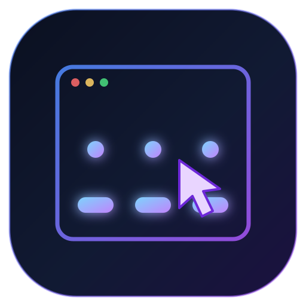

<div align="center">



# agentviews

**让 Agent 用「理解」的方式操作浏览器，而不是用「看」的方式猜坐标。**

把网页编译成一份可执行的语义视图：读节点、按名字操作、用断言验证、直接产出结构化数据。
不截图、不猜坐标、不写站点适配器，直接跑在你日常那个已经登录好、配好代理的浏览器里。

[](https://nodejs.org/)
[](LICENSE)
[]()
[]()
[]()
[]()

[这是什么](#-这是什么) • [给 Agent 的使用须知](#-给-agent-的使用须知) • [架构](#️-架构) • [安装](#-安装) • [能力](#️-能力) • [命令参考](#-命令参考) • [实测数据](#-实测数据) • [边界](#️-做不到的事)

</div>

---

## 📋 这是什么

浏览器自动化一直有两个流派：

**流派 A：截图 + 坐标。** 把页面渲染成一张图交给模型，模型输出 `click(320, 480)`。
问题不在模型不够聪明，在于**信息被压成了像素**。一张 1264×805 的截图约 1357 token，只覆盖首屏 805px；页面一重渲染，缓存坐标全部失效；点错了没有任何报错，因为 `(x,y)` 永远"合法"。

**流派 B：DOM / a11y 全树。** 把整棵无障碍树或整个 DOM 塞进上下文。
问题在**密度**：一个真实的商业页面 outerHTML 有 485 KB，全量语义树能到 32,000 字符——比截图还贵，而且 90% 的节点是不可操作的结构噪声。

**agentviews 走第三条路：编译，而不是转录。**

它把页面当成一个程序，输出一份**中间表示（IR）**——只保留"能做什么"，并为每个动作标注"做完可能发生什么"：

```json
{
  "id": "n28",
  "role": "listitem",
  "name": "豆瓣高分",
  "states": ["selected"],
  "handle": "listitem:豆瓣高分",
  "actions": [{
    "verb": "click",
    "effects": ["filter_or_view_switch", "list_replaces"],
    "preconditions": ["enabled", "scroll_into_view"],
    "reversible": true
  }],
  "provenance": "dom-structural",
  "confidence": 0.95
}
```

四个字段是关键，它们让 Agent **在动手之前先有一份预期**：

| 字段 | 提供什么 | 没有它时的处境 |
| --- | --- | --- |
| `effects` | 这个动作大概会改变什么 | 只能点完再看，一步一往返 |
| `preconditions` | 为什么点了可能没反应 | "点了没动"变成一个谜 |
| `handle`（`role:name`） | 页面重建后还能定位到同一个东西 | id 全变，句柄静默失效 |
| `provenance` / `confidence` | 这条信息有多可信 | 分不清"页面给的"和"推出来的" |

> **一句话定位**：agentviews 是 Agent 的**网页驱动层**，不是浏览器遥控器。
> 遥控器给你一棵树让你自己找；驱动层给你**能力 + 后果 + 验证**，让你少走弯路。

---

## 🧭 给 Agent 的使用须知

这一节是写给**第一次用这个工具去执行任务的 Agent** 的。前面讲设计，这里讲怎么用不出事。

### 1. 先看地图，再动手

到陌生站点，第一件事不是点，是 `map`。它按用途分组告诉你这页有什么：检索入口、导航频道、可打开的条目、账户功能、页内动作、可读内容。看完再决定路径，比盲点省很多次失败。

```bash
node agentview.mjs --ext map
```

### 2. `act` 返回 `ok` 的含义，需要你自己判断

`act` 的返回值描述的是**这一次动作派发**，不是**你的任务目标**：

```json
{"ok":true,"resolved":"self","point":[338,244]}
```

- `ok:true` — 找到了目标节点、算出了可点击位置、事件已派发。
- `resolved` — 实际被点中的是目标自己（`self`）还是它的某个子孙（`descendant:TAG`）。
- `point` — 派发坐标。
- 随后的 `settle` — DOM 安静了多久（`291ms quiet`）或是否发生了导航。

它**不承诺**业务结果。真实世界里至少有这几种情况会让 `ok:true` 之后世界没变或变得不是你要的：

| 现象 | 可能原因 | 怎么判断 |
| --- | --- | --- |
| 点了，页面毫无变化 | 目标被遮罩层盖住；事件被页面自己的逻辑吞掉；按钮处于禁用态 | 再读一次视图，看 `states` 里有没有 `disabled`；`find` 一下遮罩层 |
| 页面变了但不是你要的 | 命中了外层容器上的另一个可点祖先；同一名字对应多个元素 | 看 `resolved` 是不是 `self`；`find` 出候选后改用更精确的名字 |
| 跳到了别的页面 | 目标是链接，或者点击触发了默认跳转 | 看返回里有没有 `新标签页 → URL`，或用 `verify` 读 URL |
| 填了值但读回来是空的 | 受控组件（React/Vue）需要原生 setter 才认 | `act --text` 已走原生 setter；若仍为空，用 `eval` 读 `el.value` 对比 |
| 一切正常但目标本来就不会变 | 有些按钮只发网络请求、只弹一个提示 | 用 `eval` 看网络请求或提示节点 |

**遇到没见过的页面行为时，先收集证据再下结论**：`view` 看结构 → `find` 看候选 → `eval` 读具体 DOM 属性或状态 → 再决定是换名字、换路径，还是换命令。这份文档没法穷举所有站点的所有反常识行为，但工具给了足够的观测手段去现场定位。

判断是否真的达成目标，优先用可验证的事实，而不是"看起来变了"：

```bash
node agentview.mjs --ext verify        # {selected, checked, nodes, url}
node agentview.mjs --ext eval "JSON.stringify(document.querySelectorAll('.item').length)"
```

### 3. 标签页：关不关，取决于这次任务的性质

复用主浏览器意味着**用户可能正开着几十个标签页**。关错一个，用户丢的是他自己的上下文。所以收尾要分两种：

| 这次任务的性质 | 收尾命令 | 效果 |
| --- | --- | --- |
| **任务性**：一次性完成某件事，页面用完就没价值了 | `done` | 关闭本次自己开的标签页；用户的标签页一个不动 |
| **辅助性**：帮用户查/看/操作，页面他还要接着用 | `keep` | 什么都不关，把当前标签页与状态反馈回去 |

```bash
node agentview.mjs --ext pages        # 先看清：哪些是我开的（mine），哪些是用户的（user）
node agentview.mjs --ext done         # {closed_owned_tabs:1, user_tabs_untouched:true}
node agentview.mjs --ext keep         # {mode:"keep", kept:true, ...}
```

**默认建议**：任务完成后先 `pages` 看一眼，再决定。拿不准时选 `keep`——多留一个标签页的代价，远小于关掉用户正在读的东西。

机制上，agentviews 首次连接时会把当时**所有**标签页封存为 `baseline`，之后只可能关闭自己 `owned` 里的、且不在 `baseline` 里的。attach 模式下**永不调用 `Browser.close`**。

### 4. 撞到登录墙：交给用户，然后继续

`--ext` 驱动的是用户自己的浏览器，cookies 天然同源。真正需要人工的只有两种情况：**从没登过**，或者**要过验证码/扫码**。

```bash
node agentview.mjs --ext login-check
# {"need_login":false,"logged_in":true,"password_inputs":0,"login_named":3,
#  "hints":["登录","立即登录"],"advice":"未检测到登录要求，可继续任务"}
node agentview.mjs --ext login-watch --timeout 300
```

`login-watch` 是事件驱动的：页内监听真人动作（点击、输入、导航），用户登完就返回 `login_done`；超时如实返回 `timeout_still_login`，不会假装成功。把 `hints` 转述给用户，让他去浏览器里操作，比反复重试有效。

### 5. 采集：边滚边抓，且别把正文当链接

`collect` 处理的是虚拟列表——**滚过一屏，旧节点就被卸载**。所以它逐轮滚动、每轮抓一次、去重累积，而不是滚完再抓（那样只剩最后一屏）。

```bash
node agentview.mjs --ext collect --json --max 120 --rounds 10
```

返回结构：

```json
{
  "site": "https://search.bilibili.com/all?keyword=%E9%AC%BC%E7%95%9C",
  "count": 66,
  "rounds": 3,
  "scroll_y": 1607,
  "items": [
    {
      "title": "【万恶之源合集】“群星璀璨时，一个没看过的也是神人了”",
      "href": "https://www.bilibili.com/video/BV1LNKJ6AEei/",
      "metrics": ["116.3万", "7364", "01:31:00", "7月17日"],
      "metrics_typed": [
        {"value":"116.3万","label":"unnamed","slot":1},
        {"value":"7364","label":"unnamed","slot":2},
        {"value":"01:31:00","label":"时长"},
        {"value":"7月17日","label":"日期"}
      ],
      "text_len": 27,
      "kind": "link"
    }
  ],
  "metric_note": "label 来自数字紧邻的标签词；label=unnamed 表示页面上只有图标没有文字，slot 是它在同类指标里的序号"
}
```

读这份数据时注意四件事：

1. **`label` 只来自数字紧邻的文字标签**（播放/点赞/评论/转发/收藏/弹幕/粉丝/Star/时长/日期）。很多站点的指标只有图标没有文字，这时 `label` 是 `unnamed`，`slot` 表示它是同类指标里的第几个。**具体含义要结合页面判断**——同一个 `slot:1`，在 B 站是播放量，在别的站可能是点赞。
2. **同一个 `href` 只会出现一次**。页面上一条内容常有多个 `<a>`（标题一条、播放量/时长统计一条），采集时按 `href` 合并成一条，标题取更长的那个、指标取并集。所以 `count` 是**条目数**而不是 `<a>` 数。
3. **`kind: "content_block"` 表示这是正文块**，不是一条可跳转的条目，它的 `href` 可能是 `null`（不是每条内容都有独立链接）。不要拿它当"原帖地址"。
4. **`title` 有长度上限，长正文会被截断**。要全文用 `eval` 读具体节点的 `innerText`，或者打开详情页再 `collect`。

---

## 🏗️ 架构

```text
┌──────────────────────────────────────────────────────────────────────┐
│  Agent / LLM            决策：我要做什么                              │
└───────────────────────────────┬──────────────────────────────────────┘
                                │
┌───────────────────────────────▼──────────────────────────────────────┐
│  agentviews 驱动层                                                    │
│                                                                       │
│   读：map（这页有什么）  search（检索）  collect（出数据）  view（IR） │
│   写：act --name（按名字操作）       验：verify / settle（断言）      │
└───────────────────────────────┬──────────────────────────────────────┘
                                │
┌───────────────────────────────▼──────────────────────────────────────┐
│  传输层（可插拔，二选一）                                              │
│                                                                       │
│   bridge-ext (MV3 + chrome.debugger)   │   裸 CDP WebSocket          │
│   ExtTransport.send()                  │   --attach / --auto         │
│                    （两者接口完全同构）│                             │
└───────────────────────────────┬──────────────────────────────────────┘
                                │
┌───────────────────────────────▼──────────────────────────────────────┐
│  用户的浏览器                                                         │
│  桌面主 Chrome 的 tab · 已登录 · 已配代理 · 原生 cookies · 不重启     │
└──────────────────────────────────────────────────────────────────────┘
```

### 为什么是 `chrome.debugger` 而不是调试端口

Chrome 136+ **禁止在默认 user data dir 上开 `--remote-debugging-port`**——想用端口 attach 到"用户日常那个浏览器"，从根上就不成立：端口只能在进程启动时开，运行中的浏览器无法事后追加。

于是多数方案退而求其次：**下载一个 Chrome for Testing，跑独立 profile**。代价是那个 profile 里没有登录态、没有代理、没有扩展。这就是很多 Agent 工具一碰到"需要登录"就卡住的原因。

`chrome.debugger` 是官方文档明写的 *"an alternate transport for Chrome's remote debugging protocol"*，允许域包含 `Runtime / Page / Input / Emulation / DOM / Network / Target`——**agentviews 用到的命令全在里面**。扩展挂在浏览器内部，`attach({tabId}, '1.3')` 之后 `sendCommand()` 直接驱动同一个 tab：

```text
桌面主 Chrome（默认 profile，无调试端口，用户正常在用）
  └─ chrome.debugger.attach({tabId}) → sendCommand(method, params)
        ↑ 扩展 SW 长轮询本机 loopback 桥
  agentview.mjs  ExtTransport.send()   ← 与 class CDP.send() 完全同构
```

**结果**：被驱动的 tab 就在用户自己的浏览器窗口里，cookies / 登录态 / 代理 / 扩展全部同源。不重启、不搬 cookie、不每会话点开关。

`ExtTransport.send()` 与 `class CDP.send()` 同构，所以上层的 `evalJs / goto / act / shot / verify / audit` **一行没改**——传输层是可插拔的。

---

## 🚀 安装

零依赖。只需要 Node ≥ 20 和一个本地 Chrome / Edge。

```bash
git clone https://github.com/520mhj/agentviews.git
cd agentviews
npm link          # 之后可直接用 agentviews 命令
# 或者不装，直接跑
node agentview.mjs <命令>
```

### 加载扩展（一次，之后永久生效）

```text
1. 打开 chrome://extensions
2. 右上角打开「开发者模式」
3. 点「加载已解压的扩展程序」，选择本仓库的 bridge-ext/ 目录
4. 点扩展图标，可以改桥端口（默认 9335）
```

> **注意**：扩展 popup 显示"桥未启动"是**正常现象**。agentviews 只在执行命令时临时起桥，命令结束桥就关闭。判断安装是否成功请用 CLI 的 `probe`，不要看 popup。

### 验证安装

```bash
node agentview.mjs --ext probe
```

期望看到：

```text
# 自有扩展桥: 127.0.0.1:9335 installed=true ext=<扩展ID> v1.0.0 attached=1
#   agentviews 自有 CDP 传输：chrome.debugger API 直接驱动桌面主 Chrome 的标签页
# 可复用: 自有扩展桥 (--ext, 直连桌面主浏览器, N tabs)
```

然后跑一遍自检（需要先打开一个可访问的页面环境）：

```bash
node smoke.mjs
# 全部通过 · 9 项
```

---

## 🛠️ 能力

### 🗺️ 地图（`map`）— 先知道页面有什么，再决定做什么

Agent 面对陌生页面最大的浪费不是点错，是**不知道有什么可点**。`map` 把一级页面的能力按用途分组，每类给一句人话说明：

```bash
$ node agentview.mjs --ext map

# agentviews 地图  https://www.bilibili.com/
# 哔哩哔哩 (゜-゜)つロ 干杯~-bilibili  ·  101 个能力节点

## search  (2)  — 输入关键词并提交，检索全站内容 —— 自媒体采集的入口
  textbox:林正英                                林正英  [field.value]
  clickable:⟨clickable:nav-search-btn⟩         ⟨clickable:nav-search-btn⟩  [network_request,list_replaces]

## navigate  (22)  — 切换栏目 / 分类 / 榜单，改变当前数据集合
  clickable:消息                                 消息  [state_change]
  clickable:动态                                 动态  [state_change]
  clickable:收藏                                 收藏  [state_change]
  …+8

## open_item  (25)  — 打开一条内容详情（视频 / 推文 / 文章）
  link:中国人有自己的元素周期表？                           中国人有自己的元素周期表？  [open_new_tab]
  link:停尸间内，尸体为何凭空消失？                          停尸间内，尸体为何凭空消失？  [open_new_tab]
  …+11

## account  (3)  — 登录、反馈、设置、投稿等账户与站点功能
  clickable:立即登录                               立即登录  [network_request,list_replaces]
  clickable:点我注册                               点我注册  [state_change]

## action  (46)  — 页内操作（筛选、展开、播放、提交等）
  link:番剧                                      番剧  [open_new_tab]
  link:直播                                      直播  [open_new_tab]
  …+32

## content  (4)  — 可读文本块（标题、正文、指标数字）
  text:检测到您的页面展示可能受到浏览器插件影响，建议您将当前页面加入插件白名单…   []
```

六类固定为 `search / navigate / open_item / account / action / content`，每行是 `handle  名字  [effects]`——`handle` 可以直接拿去 `act --name`。

默认每类只留前 14 个样例（附 `…+N`），因为地图是"能力清单"不是"再发一遍整棵树"。需要全量节点加 `--full`，体积会大很多。

### 🔍 检索（`search`）— 复用同一个 tab，不反复开关

```bash
$ node agentview.mjs --ext search "鬼畜 热门"
# agentviews search  鬼畜 热门  →  https://search.bilibili.com/all?keyword=%E9%AC%BC%E7%95%9C%20%E7%83%AD%E9%97%A8
# 168 nodes · 4966 chars · 298.9× (HTML 1449.3 KB)
```

全程 `Page.navigate` 复用当前 tab，不新开窗口。地图里找不到搜索框时会退化成导航到已知搜索入口，返回里带 `fallback_navigate` 说明实际走了哪条路。

### 📊 采集（`collect`）— 直接出数据，不出 DOM

```bash
$ node agentview.mjs --ext collect --json --max 120 --rounds 10
```

```json
{
  "count": 66,
  "rounds": 3,
  "scroll_y": 1607,
  "items": [
    { "title": "【万恶之源合集】“群星璀璨时，一个没看过的也是神人了”",
      "href": "https://www.bilibili.com/video/BV1LNKJ6AEei/",
      "metrics": ["116.3万","7364","01:31:00","7月17日"],
      "metrics_typed": [{"value":"116.3万","label":"unnamed","slot":1},
                        {"value":"7364","label":"unnamed","slot":2},
                        {"value":"01:31:00","label":"时长"},
                        {"value":"7月17日","label":"日期"}],
      "kind": "link" }
  ]
}
```

逐轮滚动、每轮抓取、去重累积——虚拟列表滚过一屏会卸载旧节点，滚完再抓只能拿到最后一屏。同一 `href` 的多条 `<a>`（标题一条、统计一条）会合并成一条，所以 `count` 是条目数而不是 `<a>` 数。`--max` 控条数上限（默认 200），`--rounds` 控滚动轮数（默认 12），连续 3 轮无新增即提前收工。

指标语义靠「数字紧邻的标签词」判断，不靠"第几个数字"——后者等于给每个站点写适配器。只有图标没有文字时 `label` 为 `unnamed`，`slot` 给出同类序号，具体含义需要结合页面判断。

**为什么不用爬虫**：实测裸 HTTP（带 Chrome UA + 代理）——X 搜索页返回 `307 / 0B`，YouTube 直连 `000 / 15s`。反爬把非浏览器流量挡在门外，而浏览器流量天然合法。

### ⚡ 操作（`act` / `verify`）— 按名字，不按 id

```bash
$ node agentview.mjs --ext act --name "豆瓣高分"
act → {"ok":true,"resolved":"self","point":[338,244]}
settle → {"settled_ms":291,"reason":"quiet"}

$ node agentview.mjs --ext act --name "欧美"
act → {"ok":true,"resolved":"self","point":[238,286]}
settle → {"settled_ms":289,"reason":"quiet"}

$ node agentview.mjs --ext verify
{"url":"https://movie.douban.com/explore","selected":["豆瓣高分","欧美"],"checked":0,"nodes":72}
```

**点击策略是三层**，因为实测发现没有一层能覆盖全部：

1. **CDP 可信事件**（`Input.dispatchMouseEvent`）——需要用户激活的 `window.open` 只认可信事件，合成事件会被静默丢弃。
2. **落地检测**——派发后 80ms 检查 document 是否真的收到 `isTrusted` 的 click。没收到就说明这次派发没生效。
3. **合成 click 兜底**——直接绑 listener 的元素用 `el.click()` 就够；CDP 事件在某些会话状态下会静默丢失（三个 API 全返回 ok，document 零事件）。

返回值里的 `ok` 描述的是这一层策略的执行结果，业务目标是否达成需要另行验证——具体判断方法见 [给 Agent 的使用须知](#-给-agent-的使用须知) 第 2 条。

### 🔐 登录态 — 原生同源，不用搬

`--ext` 驱动的就是桌面主 Chrome 的 tab，**cookies 天然就是用户的**。不需要 cookie 导出桥、不需要持久 profile、不需要扫码。

撞到登录墙时是事件驱动的，不是干轮询：

```bash
node agentview.mjs --ext login-check
# {"need_login":true,"logged_in":false,"password_inputs":1,"hints":["扫码登录","验证码登录"]}
node agentview.mjs --ext login-watch --timeout 300 --idle 12 --beat 5 [--freeze]
```

页内 `window.__avWatch` 监听真人动作（`pointerdown/keydown/input/click/...`），MutationObserver + 400ms URL 轮询记页面变化；**只有事件发生才跑一次判定**，空闲时 CDP 往返趋近于零。空闲超 `--idle` 秒进 `dormant`，按 `--beat` 发心跳；`--freeze` 可选 `Page.setWebLifecycleState('frozen')` 省内存。

实测：t=6s 模拟登录完成 → **5.5s 返回 `login_done`**。超时如实报 `timeout_still_login`。

### 🧹 标签页所有权 — 只关自己开的，一个都不多

复用主浏览器时这是**删除文件级别**的谨慎：主浏览器可能开着 80 个标签页，关掉整窗等于全丢。

- 首次连接把当时**所有** tab 封存成 `baseline`（用显式 `baseline_set: true` 判据，不用"数组是否非空"——空浏览器也是合法 baseline）。
- 自己 `PUT /json/new` 开的、`target=_blank` 衍生的，全部登记为 `owned`。
- `done` / `pages --prune` 只关 `owned ∩ live − baseline`，**永远拒绝关闭任何 baseline tab**。
- 按"关闭后重新列 live 集合复核"计数，不按 `/json/close` 的响应计数。
- **attach 模式下绝不调用 `Browser.close`。**

```bash
$ node agentview.mjs --ext pages
$ node agentview.mjs --ext done
{"closed_owned_tabs":1,"user_tabs_untouched":true}
```

什么时候该 `done`、什么时候该 `keep`，见 [给 Agent 的使用须知](#-给-agent-的使用须知) 第 3 条。

### 🔇 静音 — 后台抓取不该出声

- **standalone**：Chrome 启动带 `--mute-audio`（进程级，覆盖 WebAudio / 自动播放广告）。
- **attach**：主浏览器是用户在用，加进程级静音会把所有 tab 一起静音 → 改成 `Page.addScriptToEvaluateOnNewDocument` 做 **per-target 静音**。
- 两种模式都还有页面级 `muteMedia()` IIFE 兜底。

**只静音不 `pause`**——`currentTime` 继续涨，正好当播放闭环的验收信号。

---

## 📡 命令参考

| 命令 | 说明 |
| --- | --- |
| `open <url>` | 复用当前 tab 导航（不新开窗口）、等渲染稳定、注入视图 |
| `map [--full] [--json]` | **能力地图**：按 6 类分组（检索 / 导航 / 打开条目 / 账号 / 动作 / 内容），每类给用途提示 |
| `search <关键词>` | 地图找搜索框 → 填词 → 提交 → 返回新页视图 |
| `collect [--json] [--max N] [--rounds N]` | **结构化采集**：边滚边抓，输出 `{title, href, metrics, metrics_typed, kind}` |
| `view [--json]` | 重新采样并打印语义视图 |
| `find <子串>` | 按名字找节点，返回 id / handle / role / effects / preconditions / clickable |
| `act --name <名字>` | 按名字点击；`--id n28` 也可 |
| `act --name <输入框> --text <值>` | 填值（走原生 setter，受控组件也认） |
| `verify` | 读 URL、选中项、勾选数、节点数 |
| `audit` | 召回率自检（对比 CSS 真值集合） |
| `probe [--json]` | 盘点所有 Chrome 根进程 + 扩展桥状态 + 可复用建议 |
| `login-check [--shot]` | 检测登录墙，可带截图给人看验证码 |
| `login-watch` / `login-wait` | 事件驱动等登录；空闲休眠 / 心跳 / 再激活 |
| `pages [--prune]` | 列出标签页带 `mine / user` 归属；`--prune` 只关自己开的 |
| `shot [path]` | 截图（给人看：扫码、验证码） |
| `eval <表达式>` | 逃生舱：语义覆盖不到的地方直接跑 JS |
| `keep` / `done` / `stop` | 分级销毁：保留 / 销毁自己开的 / 停 daemon |

### 全局开关

| 开关 | 说明 |
| --- | --- |
| `--ext` / `AV_EXT=1` | **推荐**：经自有扩展桥直连桌面主浏览器 |
| `--attach <port>` | attach 到任意已开调试端口的 Chrome |
| `--auto` / `AV_AUTO=1` | 自动挑：自有扩展桥 > 可达 CDP 端口 > 新建独立窗口 |
| `--json` | 机器可读输出 |
| `--headful` | 显示窗口 |
| `AV_PROXY=http://127.0.0.1:10808` | 给 standalone 浏览器配 HTTP 代理 |
| `AV_BRIDGE_PORT` | 扩展桥端口，默认 9335 |
| `AV_IDLE_MS` | daemon 空闲自动退出毫秒数，默认 120000；`0` = 不自退 |
| `AV_DEBUG=1` | 打点输出 |

---

## 📊 实测数据

### 语义视图 vs 原始 HTML（5 个真实商业站，0 个站点适配器）

| 站点 | 交互真值 | recall | view_chars | HTML KB | 压缩比 |
| --- | --- | --- | --- | --- | --- |
| douban / explore | 54 | **1.000** | 1,305 | 485 | 380.7× |
| MDN | 83 | **1.000** | 2,579 | 521 | 206.9× |
| bing / search | 66 | **1.000** | 2,705 | 496 | 187.6× |
| gov.cn | 109 | **1.000** | 2,707 | 514 | 194.4× |
| bilibili | 71 | **1.000** | 2,288 | 815 | 364.8× |
| **平均** | **76.6** | **1.000** | **2,317** | **566** | **266.9×** |

> 召回率 1.000 且**零站点适配器**——只有 5 条通用规则。关键证据：修完 MDN 的两条规则后，bilibili 的召回率**自动从 0.814 升到 1.000**。修的是通用语义缺陷，不是站点特例，规则集是**收敛**的而不是 N×M 逐个适配。

### 多步任务：名字定位 vs snapshot-ref（同任务 × 10 次）

任务：一次观察 → 点「豆瓣高分」→ 点「欧美」→ verify，**中间不重新采样**。

| 通道 | 策略 | 成功 | 静默错误 | 观察载荷 |
| --- | --- | --- | --- | --- |
| **agentviews** | 名字定位，不重采样 | **10/10** | **0/10** | **1,621 字符** |
| snapshot-ref | 缓存 ref，不重采样 | 0/10 | **10/10** | 11,371 字符 |
| snapshot-ref | 每步重新 snapshot | 10/10 | 0/10 | 22,969 字符（14.2×） |

`ref` 在列表重渲染后会漂移，而且**漂移是静默的**：点击返回 `ok:true`，读出来的选中项是 `["豆瓣高分","华语"]`——以为点的是"欧美"，实际点到了"华语"，中间没有任何报错。

二选一：要么不重采样承担 100% 静默错误，要么重采样把观察载荷翻 14.2 倍。**名字定位把这两个代价同时消掉了。**

### 真实场景资讯采集（N=3 × 3 站）

任务：到根站 → 看清页面 → 用站内搜索检索 → 整理成结构化数据。

| 场景 | 通道 | 成功率 | 驱动载荷 | 总载荷 |
| --- | --- | --- | --- | --- |
| X / trending | snapshot-ref | **0/3**（login_wall） | 2,616.7 | 2,932.7 |
| X / trending | **agentviews** | **3/3** | 7,520.3 | 9,461.7 |
| bilibili | snapshot-ref | 3/3 | 40,437.3 | 49,146 |
| bilibili | **agentviews** | 3/3 | **16,342.7（2.47×）** | **26,149（1.88×）** |
| YouTube | snapshot-ref | 3/3 | 30,463 | 43,367 |
| YouTube | **agentviews** | 3/3 | **4,871.3（6.25×）** | **11,484.7（3.78×）** |

**必须如实说的一句**：X 上 agentviews 反而更贵（7,520 vs 2,617）。原因是另一条通道被登录墙挡在门外，只看了个空页——**它"省"是因为它什么也没读到**。这个数字不能当卖点。

**真正站得住的优势是"能不能完成任务"**：X 上 0/3 vs 3/3。这来自驱动层跑在用户已登录的主浏览器里，而不是一个干净的独立 profile。

---

## 💡 用法示例

### 场景一：读一篇文章并总结

```bash
node agentview.mjs --ext open https://zhuanlan.zhihu.com/p/2028236189895770858
node agentview.mjs --ext collect --json     # 12,278 字正文，直接可读
```

> 知乎直连 `web_fetch` 返回 403（反爬）。同一个 URL 用 agentviews 打开就是正常页面——因为请求发自一个真人正在用的浏览器。

### 场景二：刷视频（含登录墙、含引导层）

```bash
node agentview.mjs --ext open https://www.bilibili.com/
node agentview.mjs --ext act --name "当我的世界下起了滴水石锥雨"
# → 新标签页 BV1MF4569E7g，t=4.13s，paused=false，muted=true

node agentview.mjs --ext open https://www.douyin.com/
node agentview.mjs --ext act --name "我知道了"        # 点掉新手引导层
node agentview.mjs --ext act --name "美国农民网购中国迷你收割机"
# → ?modal_id=7705460521306311987，t=3.86s，muted=true
```

### 场景三：接到 MCP 里

```json
{
  "mcpServers": {
    "agentviews": {
      "command": "node",
      "args": ["C:/path/to/agentviews/mcp.mjs"],
      "env": { "AGENTVIEWS_TRANSPORT": "ext" }
    }
  }
}
```

15 个工具，覆盖上面所有能力：

| 工具 | 对应命令 |
| --- | --- |
| `av_open` / `av_view` / `av_map` / `av_find` | `open` / `view` / `map` / `find` |
| `av_act` / `av_verify` | `act` / `verify` |
| `av_search` / `av_collect` | `search` / `collect` |
| `av_login_check` / `av_login_watch` | `login-check` / `login-watch` |
| `av_pages` / `av_done` / `av_keep` | `pages` / `done` / `keep` |
| `av_eval` / `av_shot` | `eval` / `shot` |

`AGENTVIEWS_TRANSPORT` 决定传输层：`ext`（默认，扩展桥）｜`auto`｜`standalone`｜`attach:<port>`。

### 场景四：只取提取器

`extract.js` 本身零依赖，可以只拿它 + 自己的 CDP 通道。注入后 API 挂在 `window.__av` 上：

```js
import { readFileSync } from 'node:fs';

const src = readFileSync('extract.js', 'utf8');
await cdp.send('Runtime.evaluate', { expression: src });

// view 是字符串属性（已渲染好的文本视图），不是函数
const { result } = await cdp.send('Runtime.evaluate', {
  expression: 'window.__av.view', returnByValue: true
});

// 结构化数据用 nodes / stats
const nodes = await cdp.send('Runtime.evaluate', {
  expression: 'window.__av.nodes', returnByValue: true
});
```

可用成员：`nodes`（节点数组）、`view`（文本视图，字符串）、`stats`（统计）、`map()`、`find()` / `byName()`、`act({id|name, verb, text})`、`predict(id)`、`probe(id)`、`audit()`、`settle(ms)`、`verify()`。

---

## ⚠️ 做不到的事

写清楚边界，比写清楚能力更重要。

- **Canvas / 自绘 UI 无效**（地图、视频编辑器、游戏）。这类页面没有 DOM 语义，视觉通道仍然必需——**两个后端并存是终态，不是过渡方案**。
- **验证码、强反爬没处理**。撞上走 `login-watch` 人工过一次，之后同源复用。
- **跨域 iframe / 闭合 Shadow DOM 只做了开放 Shadow DOM**。
- **15.3% 的 effect 仍落到兜底 `state_change`**（标 `weak`，不计入准确率）。这些预测的命中属同义反复，不算证据。
- **跨更多站点的 10+ 步长任务**静默错误率还没量。已量的是 3 步 × 10 次。
- **桌面主 Chrome 仍然不能端口 attach**（Chrome 136+ 限制）。能连是因为 `chrome.debugger` 换了传输层，不是绕过了端口限制。
- **页面行为无法穷举**。这份文档列的是常见情况，不是全部。遇到没见过的行为，用 `view` / `find` / `eval` 收集证据现场定位——工具给了观测手段，判断留给执行者。

---

## 📁 文件

| 文件 | 说明 |
| --- | --- |
| `agentview.mjs` | CLI + 自写 CDP 客户端 + 常驻 daemon + probe/--auto/--ext + attach/所有权/分级销毁 + 事件驱动登录 + 地图/search/collect（约 1,590 行） |
| `extract.js` | 视图提取器（注入页面，约 710 行，零依赖，`VERSION 8.0`） |
| `avbridge.mjs` | 零依赖 loopback 桥（`/pull` 长轮询 / `/push` 回结果 / job 超时） |
| `bridge-ext/` | MV3 扩展：`manifest.json` / `sw.js`（`chrome.debugger` 作 CDP 传输）/ `popup.html` / `popup.js` |
| `mcp.mjs` | MCP server（stdio，15 个工具） |
| `smoke.mjs` | 端到端自检（9 项断言） |
| `CHROMEWEBSTORE.md` | 逐权限说明（上架用） |
| `LICENSE` | MIT |

### 设计约束（都是被实测逼出来的，不是偏好）

1. **用名字定位，不用 id。** 页面重建后 id 全变，名字还在。节点同时带 `handle = role:name`。
2. **动作后等 DOM 安静，不等固定 sleep。** `__av.settle(4000)` 用 MutationObserver：静默 250ms 即返回，实测 289–676ms。
3. **会离开当前页的动作不在页内验证。** `navigate / form_submit / open_new_tab / download` 归为 `skipped: would_leave_page`，交给 URL 或新标签页判定。
4. **只碰自己开的标签页。** 用户的标签页一个都不动。

---

## 关于这个仓库

**这个仓库是 agentviews 自己提交的。**

从 review 代码、修 bug、清理内部迭代痕迹、生成图标、写这份 README，到在浏览器里打开 GitHub 创建仓库、推送文件——全程由 agentviews 驱动，没有手工上传一个文件。

- 首次提交：`2026-11-09 20:37 → 21:10`，**33 分钟**（含 3 个 bug 的定位与修复、8 轮 README 重写、图标绘制、建仓与推送）
- 后续修订：`2026-11-10 22:21 → 22:55`，**约 34 分钟**（另一模型使用本项目后报回 5 条问题，逐条核对源码、修掉 2 个真 bug、重写这份 README 的使用须知）

这不是噱头。它恰好是这个项目最想证明的事：**Agent 不需要"看"网页才能操作网页**。写这份 README 的时候，读的是自己 `map` 出来的能力清单，点的是自己 `find` 出来的节点名字，验证用的是自己 `verify` 出来的结构化状态——**用同一个工具描述它自己**。

第二次修订还有一层意思：那些问题是**另一个 Agent 读文档、跑命令时发现的**。文档写得对不对、示例跑不跑得通、`ok` 之后世界到底变没变——这些只有真的照着文档做一遍才会暴露。所以这份 README 里的每段输出都是真跑出来的，不是照着代码脑补的。

---

<div align="center">

**如果这个项目让你少写了一次坐标，它就值了。**

MIT © [AvaTaring](https://github.com/520mhj)

</div>
