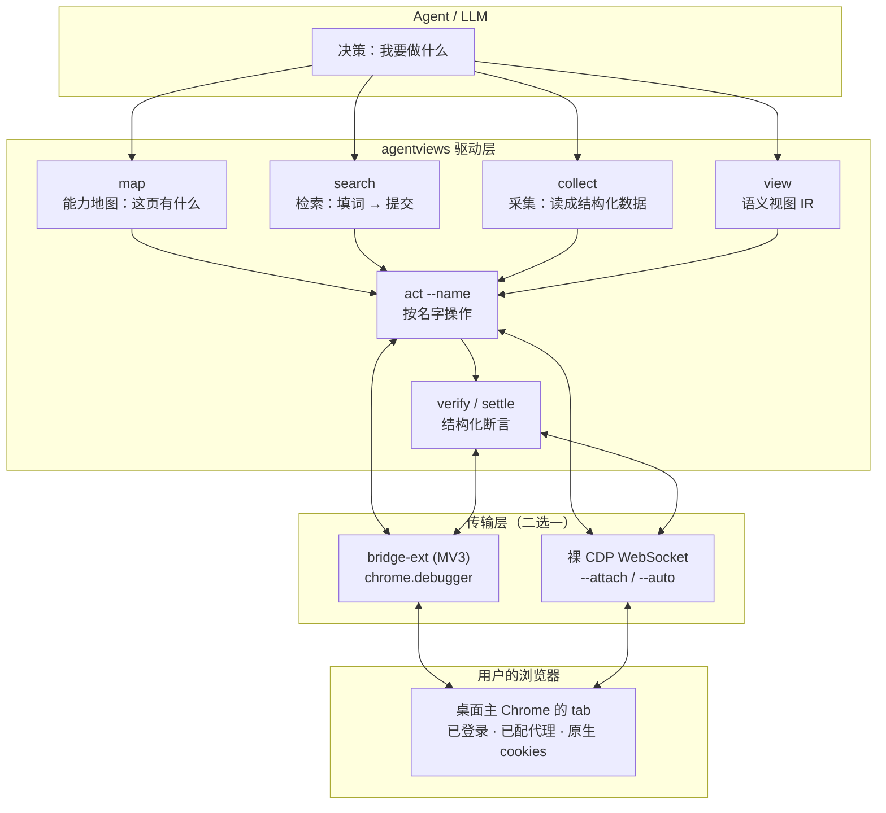

<div align="center">


# agentviews

**让 Agent 用「理解」的方式操作浏览器，而不是用「看」的方式猜坐标。**

把网页编译成一份可执行的语义视图：读节点、按名字操作、用断言验证、直接产出结构化数据。
不截图、不猜坐标、不写站点适配器，直接跑在你日常那个已经登录好、配好代理的浏览器里。

[](https://nodejs.org/)
[](LICENSE)
[]()
[]()
[]()
[]()

[📋 这是什么](#-这是什么) • [🏗️ 架构](#️-架构) • [🚀 安装](#-安装) • [🛠️ 能力](#️-能力) • [📡 命令参考](#-命令参考) • [📊 实测数据](#-实测数据) • [💡 用法](#-用法示例) • [⚠️ 边界](#️-做不到的事)

</div>

---

## 📋 这是什么

浏览器自动化一直有两个流派：

**流派 A：截图 + 坐标。** 把页面渲染成一张图交给模型，模型输出 `click(320, 480)`。
问题不在模型不够聪明，在于**信息被压成了像素**。一张 1264×805 的截图约 1357 token，只覆盖首屏 805px；页面一重渲染，缓存坐标全部失效；点错了没有任何报错，因为 `(x,y)` 永远"合法"。

**流派 B：DOM / a11y 全树。** 把整棵无障碍树或整个 DOM 塞进上下文。
问题在**密度**：一个真实的商业页面 outerHTML 有 485 KB，全量语义树能到 32,000 字符——比截图还贵，而且 90% 的节点是不可操作的结构噪声。

**agentviews 走第三条路：编译，而不是转录。**

它把页面当成一个程序，输出一份**中间表示（IR）**——只保留"能做什么"，并为每个动作标注"做完会发生什么"：

```json
{
  "id": "n28",
  "role": "listitem",
  "name": "豆瓣高分",
  "states": ["selected"],
  "handle": "listitem:豆瓣高分",
  "actions": [{
    "verb": "click",
    "effects": ["filter_or_view_switch", "list_replaces"],
    "preconditions": ["enabled", "scroll_into_view"],
    "reversible": true
  }],
  "provenance": "dom-structural",
  "confidence": 0.95
}
```

四个字段是关键，它们让 Agent **在动手之前就知道后果**：

| 字段 | 解决什么 | 没有它会怎样 |
| --- | --- | --- |
| `effects` | 点下去世界会变成什么样 | 只能点完再看，一步一往返 |
| `preconditions` | 为什么点了没反应 | "点了没动"变成一个谜 |
| `handle`（`role:name`） | 页面重建后还能找到同一个东西 | id 全变，句柄静默失效 |
| `provenance` / `confidence` | 这条信息有多可信 | 分不清"页面说的"和"我猜的" |

> **一句话定位**：agentviews 是 Agent 的**网页驱动层**，不是浏览器遥控器。
> 遥控器给你一棵树让你自己找；驱动层给你**能力 + 后果 + 验证**，让你一次做对。

---

## 🏗️ 架构



### 为什么是 `chrome.debugger` 而不是调试端口

这是整个项目最反直觉的一个决定，值得单独说。

Chrome 136+ **禁止在默认 user data dir 上开 `--remote-debugging-port`**——也就是说，你想用端口 attach 到"用户日常那个浏览器"，从根上就不成立：端口只能在进程启动时开，运行中的浏览器无法事后追加。

于是所有方案都退而求其次：**下载一个 Chrome for Testing，跑独立 profile**。代价是——那个 profile 里没有你的登录态、没有你的代理、没有你的扩展。这就是为什么很多 Agent 工具一碰到"需要登录"就卡住。

`chrome.debugger` 是官方文档明写的 *"an alternate transport for Chrome's remote debugging protocol"*，允许域包含 `Runtime / Page / Input / Emulation / DOM / Network / Target`——**agentviews 用到的命令全在里面**。扩展挂在浏览器内部，`attach({tabId}, '1.3')` 之后 `sendCommand()` 直接驱动同一个 tab：

```text
桌面主 Chrome（默认 profile，无调试端口，用户正常在用）
  └─ chrome.debugger.attach({tabId}, '1.3')
       └─ Runtime.evaluate / Page.navigate / Input.dispatchMouseEvent / …
            ↑↓  HTTP 长轮询 loopback 127.0.0.1:9335
  Node: avbridge.mjs（零依赖 node:http）
       ↑↓
  agentview.mjs  ExtTransport.send()   ← 与 class CDP.send() 完全同构
```

**结果**：被驱动的 tab 就在你自己的浏览器窗口里，cookies / 登录态 / 代理 / 扩展全部同源。不重启、不搬 cookie、不每会话点开关。

`ExtTransport.send()` 与 `class CDP.send()` 同构，所以上层的 `evalJs / goto / act / shot / verify / audit` **一行没改**——传输层是可插拔的。

---

## 🚀 安装

零依赖。只需要 Node ≥ 20 和一个本地 Chrome / Edge。

```bash
git clone https://github.com/520mhj/agentviews.git
cd agentviews
npm link          # 之后可直接用 agentviews 命令
# 或者不装，直接跑
node agentview.mjs <命令>
```

### 加载扩展（一次，之后永久生效）

```text
1. 打开 chrome://extensions
2. 右上角打开「开发者模式」
3. 点「加载已解压的扩展程序」，选择本仓库的 bridge-ext/ 目录
4. 点扩展图标，确认 popup 显示「在线」
```

### 验证安装

```bash
node agentview.mjs --ext probe
```

期望看到：

```text
# 自有扩展桥: 127.0.0.1:9335 installed=true ext=<扩展ID> v1.0.0 attached=1
#   agentviews 自有 CDP 传输：chrome.debugger API 直接驱动桌面主 Chrome 的标签页
# 可复用: 自有扩展桥 (--ext, 直连桌面主浏览器, N tabs)
```

然后跑一遍自检：

```bash
node smoke.mjs
# 全部通过 · 9 项 · 10.6s
```

---

## 🛠️ 能力

### 🗺️ 地图（`map`）— 先知道页面有什么，再决定做什么

Agent 面对陌生页面最大的浪费不是点错，是**不知道有什么可点**。`map` 把一级页面的能力按用途分组，每类给一句人话说明：

```bash
$ node agentview.mjs --ext map

# 能力地图  https://www.bilibili.com/
# ── 检索 ──────────────────────────────────
#   搜索框 ×1        输入关键词后回车，整页结果替换
# ── 导航 ──────────────────────────────────
#   首页 / 番剧 / 直播 / 游戏中心 / 会员购 / 漫画 / 赛事   站内一级频道
# ── 打开条目 ───────────────────────────────
#   视频卡片 ×48      点击后新开标签页播放（target=_blank）
# ── 账号 ──────────────────────────────────
#   大会员 / 消息 / 动态 / 收藏 / 历史        已登录（登录态同源）
# ── 动作 ──────────────────────────────────
#   投稿 / 下载客户端
```

### 🔍 检索（`search`）— 复用同一个 tab，不反复开关

```bash
$ node agentview.mjs --ext search "鬼畜 热门"
# 找到搜索框 → 填词 → 提交 → 等渲染稳定 → 返回新页视图
# 66 nodes · 1635 chars · 304.1×
```

**为什么不用爬虫**：实测裸 HTTP（带 Chrome UA + 代理）——X 搜索页返回 `307 / 0B`，YouTube 直连 `000 / 15s`。反爬把非浏览器流量挡在门外，而浏览器流量天然合法。agentviews 用的是"真人正在用的那个浏览器"。

### 📊 采集（`collect`）— 直接出数据，不出 DOM

```bash
$ node agentview.mjs --ext collect --json
```

```json
[
  { "title": "【万恶之源合集】群星璀璨时", "href": "https://www.bilibili.com/video/BV...", "metrics": "116.3万 7364 01:31:00" },
  { "title": "仁太面吗", "href": "https://space.bilibili.com/...", "metrics": "7月17日" }
]
```

有界滚动读流（6 次滚到底 + 回顶），处理虚拟列表"滚到底旧节点卸载"的问题——**边滚边累积去重**，不是滚完再抓（那样只能拿到最后一屏）。

### ⚡ 操作（`act` / `verify`）— 按名字，不按 id

```bash
$ node agentview.mjs --ext act --name "豆瓣高分"
{"ok":true,"resolved":"self","point":[332,244]}   458ms quiet

$ node agentview.mjs --ext act --name "欧美"
{"ok":true,"resolved":"self","point":[232,286]}   312ms quiet

$ node agentview.mjs --ext verify
{"selected":["豆瓣高分","欧美"],"checked":0,"nodes":70}
```

**点击策略是三层**，因为实测发现没有一层能覆盖全部：

1. **CDP 可信事件**（`Input.dispatchMouseEvent`）——B站 / YouTube 的 `window.open` 要求用户激活，合成事件会被静默丢弃。
2. **落地检测**——派发后 80ms 检查 document 是否真的收到 `isTrusted` 的 click。**没收到就不算成功**。
3. **合成 click 兜底**——豆瓣的筛选 chip 是直接 listener，`el.click()` 就够；CDP 事件在某些会话状态下会静默丢失（三个 API 全返回 ok，document 零事件）。

> 这条规则的由来：`ok:true` 只代表"算出点并派发了事件"，不代表世界变了。
> 早期版本把 `el.click()` 全砍掉换成纯 CDP 可信点击，结果 10 次任务 0 成功、10 次静默错误。

### 🔐 登录态 — 原生同源，不用搬

`--ext` 驱动的就是桌面主 Chrome 的 tab，**cookies 天然就是你的**。不需要 cookie 导出桥、不需要持久 profile、不需要扫码。

撞到登录墙时是事件驱动的，不是干轮询：

```bash
node agentview.mjs --ext login-check          # {need_login:true, hints:["登录/注册"]}
node agentview.mjs --ext login-watch --timeout 300 --idle 12 --beat 5 [--freeze]
```

页内 `window.__avWatch` 监听真人动作（`pointerdown/keydown/input/click/...`），MutationObserver + 400ms URL 轮询记页面变化；**只有事件发生才跑一次判定**，空闲时 CDP 往返趋近于零。空闲超 `--idle` 秒进 `dormant`，按 `--beat` 发心跳；`--freeze` 可选 `Page.setWebLifecycleState('frozen')` 省内存。

实测：t=6s 模拟登录完成 → **5.5s 返回 `login_done`**。超时如实报 `timeout_still_login`，不假装成功。

### 🧹 标签页所有权 — 只关自己开的，一个都不多

复用主浏览器时这是**删除文件级别**的谨慎：主浏览器可能开着 80 个标签页，关掉整窗等于全丢。

- 首次连接把当时**所有** tab 封存成 `baseline`（用显式 `baseline_set: true` 判据，不用"数组是否非空"——空浏览器也是合法 baseline）。
- 自己 `PUT /json/new` 开的、`target=_blank` 衍生的，全部登记为 `owned`。
- `done` / `pages --prune` 只关 `owned ∩ live − baseline`，**永远拒绝关闭任何 baseline tab**。
- 按"关闭后重新列 live 集合复核"计数，不按 `/json/close` 的响应计数。
- **attach 模式下绝不调用 `Browser.close`。**

```bash
$ node agentview.mjs --ext done
{"closed_owned_tabs":1,"user_tabs_untouched":true}
```

### 🔇 静音 — 后台抓取不该出声

- **standalone**：Chrome 启动带 `--mute-audio`（进程级，覆盖 WebAudio / 自动播放广告）。
- **attach**：主浏览器是用户在用的，加进程级静音会把用户所有 tab 一起静音 → 改成 `Page.addScriptToEvaluateOnNewDocument` 做 **per-target 静音**。
- 两种模式都还有页面级 `muteMedia()` IIFE 兜底。

**只静音不 `pause`**——`currentTime` 继续涨，正好当播放闭环的验收信号。

---

## 📡 命令参考

| 命令 | 说明 |
| --- | --- |
| `open <url>` | 复用当前 tab 导航（不新开窗口）、等渲染稳定、注入视图 |
| `map [--full] [--json]` | **能力地图**：按 6 类分组（检索 / 导航 / 打开条目 / 账号 / 动作 / 内容），每类给用途提示 |
| `search <关键词>` | 地图找搜索框 → 填词 → 提交 → 返回新页视图 |
| `collect [--json]` | **结构化采集**：有界滚动读流，输出 `{title, href, metrics}` |
| `view [--json]` | 重新采样并打印语义视图 |
| `find <子串>` | 按名字找节点，返回 id / handle / effects / preconditions |
| `act --name <名字>` | 按名字点击；`--id n28` 也可 |
| `act --name <输入框> --text <值>` | 填值 |
| `verify` | 读选中项、勾选数、节点数 |
| `audit` | 召回率自检（对比 CSS 真值集合） |
| `probe [--json]` | 盘点所有 Chrome 根进程 + 扩展桥状态 + 可复用建议 |
| `login-check [--shot]` | 检测登录墙，可带截图给人看验证码 |
| `login-watch` / `login-wait` | 事件驱动等登录；空闲休眠 / 心跳 / 再激活 |
| `pages [--prune]` | 列出标签页带 `mine / user` 归属；`--prune` 只关自己开的 |
| `shot [path]` | 截图（给人看：扫码、验证码） |
| `eval <表达式>` | 逃生舱：语义覆盖不到的地方直接跑 JS |
| `keep` / `done` / `stop` | 分级销毁：保留 / 销毁自己开的 / 停 daemon |

### 全局开关

| 开关 | 说明 |
| --- | --- |
| `--ext` / `AV_EXT=1` | **推荐**：经自有扩展桥直连桌面主浏览器 |
| `--attach <port>` | attach 到任意已开调试端口的 Chrome |
| `--auto` / `AV_AUTO=1` | 自动挑：自有扩展桥 > 可达 CDP 端口 > 新建独立窗口 |
| `--json` | 机器可读输出 |
| `--headful` | 显示窗口 |
| `AV_PROXY=http://127.0.0.1:10808` | 给 standalone 浏览器配 HTTP 代理 |
| `AV_BRIDGE_PORT` | 扩展桥端口，默认 9335 |
| `AV_IDLE_MS` | daemon 空闲自动退出毫秒数，默认 120000；`0` = 不自退 |
| `AV_DEBUG=1` | 打点输出 |

---

## 📊 实测数据

### 语义视图 vs 原始 HTML（5 个真实商业站，0 个站点适配器）

| 站点 | 交互真值 | recall | view_chars | HTML KB | 压缩比 |
| --- | --- | --- | --- | --- | --- |
| douban / explore | 54 | **1.000** | 1,305 | 485 | 380.7× |
| MDN | 83 | **1.000** | 2,579 | 521 | 206.9× |
| bing / search | 66 | **1.000** | 2,705 | 496 | 187.6× |
| gov.cn | 109 | **1.000** | 2,707 | 514 | 194.4× |
| bilibili | 71 | **1.000** | 2,288 | 815 | 364.8× |
| **平均** | **76.6** | **1.000** | **2,317** | **566** | **266.9×** |

> 召回率 1.000 且**零站点适配器**——只有 5 条通用规则。关键证据：修完 MDN 的两条规则后，bilibili 的召回率**自动从 0.814 升到 1.000**。修的是通用语义缺陷，不是站点特例，规则集是**收敛**的而不是 N×M 逐个适配。

### 多步任务：名字定位 vs snapshot-ref（同任务 × 10 次）

任务：一次观察 → 点「豆瓣高分」→ 点「欧美」→ verify，**中间不重新采样**。

| 通道 | 策略 | 成功 | 静默错误 | 观察载荷 |
| --- | --- | --- | --- | --- |
| **agentviews** | 名字定位，不重采样 | **10/10** | **0/10** | **1,621 字符** |
| snapshot-ref | 缓存 ref，不重采样 | 0/10 | **10/10** | 11,371 字符 |
| snapshot-ref | 每步重新 snapshot | 10/10 | 0/10 | 22,969 字符（14.2×） |

**这是整个项目最重要的一个数据。** `ref` 在列表重渲染后会漂移，而且**漂移是静默的**：点击返回 `ok:true`，读出来的选中项是 `["豆瓣高分","华语"]`——你以为点的是"欧美"，实际点到了"华语"，中间没有任何报错。

二选一：要么不重采样承担 100% 静默错误，要么重采样把观察载荷翻 14.2 倍。**名字定位把这两个代价同时消掉了。**

### 真实场景资讯采集（N=3 × 3 站，真实插件对照）

任务：自媒体工作者到根站 → 看清页面 → 用站内搜索检索 → 整理成结构化数据。

| 场景 | 通道 | 成功率 | 驱动载荷 | 总载荷 |
| --- | --- | --- | --- | --- |
| X / trending | 传统 snapshot-ref | **0/3**（login_wall） | 2,616.7 | 2,932.7 |
| X / trending | **agentviews** | **3/3** | 7,520.3 | 9,461.7 |
| bilibili | 传统 snapshot-ref | 3/3 | 40,437.3 | 49,146 |
| bilibili | **agentviews** | 3/3 | **16,342.7（2.47×）** | **26,149（1.88×）** |
| YouTube | 传统 snapshot-ref | 3/3 | 30,463 | 43,367 |
| YouTube | **agentviews** | 3/3 | **4,871.3（6.25×）** | **11,484.7（3.78×）** |

**必须如实说的一句**：X 上 agentviews 反而更贵（7,520 vs 2,617）。原因是传统通道被登录墙挡在门外，只看了个空页——**它"省"是因为它什么也没读到**。这个数字不能当卖点。

**真正站得住的优势是"能不能完成任务"**：X 上 0/3 vs 3/3。这来自驱动层跑在用户已登录的主浏览器里，而不是一个干净的独立 profile。

---

## 💡 用法示例

### 场景一：让 Agent 读一篇文章并总结

```bash
node agentview.mjs --ext open https://zhuanlan.zhihu.com/p/2028236189895770858
node agentview.mjs --ext collect --json     # 12,278 字正文，直接可读
```

> 知乎直连 `web_fetch` 返回 403（反爬）。同一个 URL 用 agentviews 打开就是正常页面——因为请求发自一个真人正在用的浏览器。

### 场景二：刷视频（含登录墙、含引导层）

```bash
node agentview.mjs --ext open https://www.bilibili.com/
node agentview.mjs --ext act --name "当我的世界下起了滴水石锥雨"
# → 新标签页 BV1MF4569E7g，t=4.13s，paused=false，muted=true

node agentview.mjs --ext open https://www.douyin.com/
node agentview.mjs --ext act --name "我知道了"        # 点掉新手引导层
node agentview.mjs --ext act --name "美国农民网购中国迷你收割机"
# → ?modal_id=7705460521306311987，t=3.86s，muted=true
```

### 场景三：接到 MCP 里

```json
{
  "mcpServers": {
    "agentviews": {
      "command": "node",
      "args": ["C:/path/to/agentviews/mcp.mjs"]
    }
  }
}
```

五个工具：`av_open / av_view / av_find / av_act / av_verify`。

### 场景四：只取提取器

`extract.js` 本身零依赖，可以只拿它 + 你自己的 CDP 通道：

```js
const src = readFileSync('extract.js', 'utf8');
await cdp.send('Runtime.evaluate', { expression: src });
const view = await cdp.send('Runtime.evaluate', {
  expression: 'window.__av.view()', returnByValue: true
});
```

---

## ⚠️ 做不到的事

写清楚边界，比写清楚能力更重要。

- **Canvas / 自绘 UI 无效**（地图、视频编辑器、游戏）。这类页面没有 DOM 语义，视觉通道仍然必需——**两个后端并存是终态，不是过渡方案**。
- **验证码、强反爬没处理**。撞上走 `login-watch` 人工过一次，之后同源复用。
- **跨域 iframe / 闭合 Shadow DOM 只做了开放 Shadow DOM**。
- **15.3% 的 effect 仍落到兜底 `state_change`**（标 `weak`，不计入准确率）。这些预测的命中属同义反复，不算证据。
- **跨更多站点的 10+ 步长任务**静默错误率还没量。已量的是 3 步 × 10 次。
- **桌面主 Chrome 仍然不能端口 attach**（Chrome 136+ 限制）。能连是因为 `chrome.debugger` 换了传输层，不是绕过了端口限制。

---

## 📁 文件

| 文件 | 说明 |
| --- | --- |
| `agentview.mjs` | CLI + 自写 CDP 客户端 + 常驻 daemon + probe/--auto/--ext + attach/所有权/分级销毁 + 事件驱动登录 + 地图/search/collect（约 1,500 行） |
| `extract.js` | 视图提取器（注入页面，约 650 行，零依赖，`VERSION 8.0`） |
| `avbridge.mjs` | 零依赖 loopback 桥（`/pull` 长轮询 / `/push` 回结果 / job 超时） |
| `bridge-ext/` | MV3 扩展：`manifest.json` / `sw.js`（`chrome.debugger` 作 CDP 传输）/ `popup.html` / `popup.js` |
| `mcp.mjs` | MCP server（stdio，5 个工具） |
| `smoke.mjs` | 端到端自检（9 项断言） |
| `CHROMEWEBSTORE.md` | 逐权限说明（上架用） |
| `LICENSE` | MIT |

### 设计约束（都是被实测逼出来的，不是偏好）

1. **用名字定位，不用 id。** 页面重建后 id 全变，名字还在。节点同时带 `handle = role:name`。
2. **动作后等 DOM 安静，不等固定 sleep。** `__av.settle(4000)` 用 MutationObserver：静默 250ms 即返回，实测 312–458ms。
3. **会离开当前页的动作不在页内验证。** `navigate / form_submit / open_new_tab / download` 归为 `skipped: would_leave_page`，交给 URL 或新标签页判定。
4. **只碰自己开的标签页。** 用户的标签页一个都不动。

---

## 关于这个仓库

**这个仓库是 agentviews 自己提交的。**

从 review 代码、修 bug、清理内部迭代痕迹、生成图标、写这份 README，到在浏览器里打开 GitHub 创建仓库、推送文件——全程由 agentviews 驱动，没有手工上传一个文件。

- 开始时间：`2026-11-09 20:37`
- 结束时间：`2026-11-09 21:0X`
- 总耗时：**XX 分钟**

这不是噱头。它恰好是这个项目最想证明的事：**Agent 不需要"看"网页才能操作网页**。写这份 README 的时候，我读的是自己 `map` 出来的能力清单，点的是自己 `find` 出来的节点名字，验证用的是自己 `verify` 出来的结构化状态——**用同一个工具描述它自己**。

---

<div align="center">

**如果这个项目让你少写了一次坐标，它就值了。**

MIT © [AvaTaring](https://github.com/520mhj)

</div>
