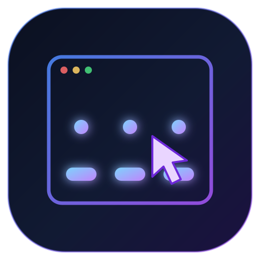

<p align="center">
  
</p>

# AgentViews · avs

**让 Agent 用「理解」的方式操作浏览器，而不是用「看」的方式猜坐标。**

把网页编译成一份可执行的语义视图：**读节点、按名字操作、用断言验证、直接产出结构化数据。**

默认不截图、不猜坐标、不写站点适配器，直接跑在你日常那个已经登录好、配好代理的浏览器里。

AVS 是浏览器工具，不是另一个 Agent。**任务怎么规划、页面怎么理解、结果如何验收，由使用它的 Agent 决定。** AVS 提供观察、定位、执行、验证和恢复能力；未知页面不会被硬编码为某个固定流程。

[快速开始](#快速开始) · [核心能力](#核心能力) · [持续监听](#持续监听与会话恢复) · [Agent 接入](#agent-接入) · [操作确认](#操作确认) · [文档](#文档)

## 核心能力

| 能力 | AVS 提供什么 |
| --- | --- |
| 可执行语义视图 | 节点的角色、名字、状态、动作、来源和置信度；限量观察、变化摘要与按目标全文读取 |
| 语义操作与验证 | 名字/角色唯一定位，文档级节点身份，执行前检查可见、禁用、遮挡与目标变化，执行后用新鲜页面断言 |
| 文件与目录上传 | 原生文件输入、关联拖放区、目录层级与内容摘要；上传前单次确认，不打开系统文件选择窗口 |
| 日常浏览器 | 扩展连接现有 Chromium 浏览器，复用其登录态与代理；不要求另建自动化账号环境 |
| 后台与静音 | 工具新建标签页默认后台、静音；不用选中窗口也能操作，不暂停媒体 |
| 当前标签页 | 用户明确指定时沿用当前页，不新开、不中途换页、不关闭用户标签页 |
| 持续只读监听 | 独立采样进程、变化游标、有界事件记录；Agent 回合结束后仍可观察，重新接入时恢复原目标 |
| 用户控制 | 重要操作默认请求确认；用户可授权 Agent 执行一次、亲自操作或取消；未知控件交回 Agent 分析 |

默认循环：**观察 → 理解 → 定位 → 执行 → 再观察 → 验证。**

页面变化或名字歧义时，Agent 重新读取地图，而不是猜坐标、盲目重放或偷偷换站。`shot` 仅是按需辅助，不是默认决策路径。

## 快速开始

**复制下面任意一段完整指令，发送给你使用的 Agent。命令由 Agent 执行，不需要用户运行终端。**

前提：Agent 有本机终端权限，已安装 Node.js 22+，浏览器支持 Chromium 扩展调试接口。云端 Agent 不会因为安装工具就获得用户本机浏览器访问权。

### 方式一：由 Agent 自动安装并初始化

```text
请在本机为当前 Agent 初始化 AgentViews（avs），采用自动安装扩展流程。
项目：https://github.com/520mhj/agentviews
由你执行：npx --yes --package=github:520mhj/agentviews avs init auto
安装工具与当前 Agent 可识别的 skill，读取安装后的 SKILL.md，再检查浏览器和扩展连接。
只有扩展实际验证可用、并成功打开新后台标签页，才回复“初始化完成，可以开始浏览器任务”。
浏览器不允许自动加载扩展时，展示实际 extension_path，指导我手动导入；不要绕过浏览器策略。
需要手动导入时，等我回复“已完成导入扩展”，再通过已安装 skill 的 runner 执行 init verify。
不要要求我运行终端命令，不要重启或修改我的浏览器配置，也不要执行支付、删除或不可逆操作。
```

流程：**安装工具与技能 → 探测浏览器 → 加载/验证扩展 → 新开后台页 → 反馈完成。**

普通 Chrome、Edge 等可能要求手动导入扩展。独立 Chromium 配置目录即使允许自动加载，也不会继承日常浏览器的登录态；Agent 必须说明当前连接的环境，不能把等待导入当成初始化成功。

### 方式二：Agent 安装工具，用户手动导入扩展

```text
请在本机为当前 Agent 初始化 AgentViews（avs），采用手动导入扩展流程。
项目：https://github.com/520mhj/agentviews
由你执行：npx --yes --package=github:520mhj/agentviews avs init manual
先安装工具与当前 Agent 可识别的 skill，读取安装后的 SKILL.md，展示实际 extension_path 和导入步骤。
不要尝试自动安装扩展；等待我在浏览器中开启开发者模式、加载该扩展目录，并回复“已完成导入扩展”。
收到反馈后，通过已安装 skill 的 runner 执行 init verify，验证连接并自动打开新后台标签页。
两项都成功才回复“初始化完成，可以开始浏览器任务”；失败时报告实际原因。
不要要求我运行终端命令，不要覆盖已有 Agent 配置，不要执行支付、删除或不可逆操作。
```

流程：**安装工具与技能 → 返回导入目录 → 等待用户导入 → 验证扩展 → 新开后台页 → 反馈完成。**

用户只需按 Agent 返回的实际目录导入扩展并反馈完成。后续验证由 Agent 执行，不凭扩展图标或用户一句“完成”就宣布可用。

## 使用方式

初始化后，向 Agent 描述任务、指定来源与验收要求即可。它决定是否新开页面、读取哪些节点、如何验证结果，以及何时结束任务。

### 后台与静音标签页

工具新建页默认不激活窗口，并使用浏览器原生标签页静音；媒体元素策略覆盖动态出现的 `<video>` / `<audio>`。**静音不等于暂停。**

用户自己的当前页不被擅自静音。高级 CDP 模式的媒体元素策略不宣称覆盖所有 WebAudio 实现；网站冻结、懒加载和系统休眠仍可能影响后台操作。

### 使用当前标签页

明确告诉 Agent：**“使用浏览器当前标签页，不要新开页面。”**

Agent 通过 `--ext --current map` 或 MCP `av_current` 选择最后聚焦窗口中的活动页，此后固定原目标。即使用户切到其他标签页，后续命令也不跟着切换。任务结束保留原页；目标消失时报告限制，不创建替代页面。

## 持续监听与会话恢复

AVS 将**浏览器观察**与 **Agent 推理回合**分开。调用方可以为已授权的目标启动只读监听，随后按游标读取变化，而不是让一次工具调用结束等同于任务结束。

以下命令供 Agent 参考；安装后通过 skill 的 `scripts/avs.mjs` 调用，不要求全局安装 `avs`：

```bash
avs --ext watch start --timeout 3600 --beat 1
avs watch status
avs watch poll --after 0 --timeout 5
avs --ext watch resume
avs watch stop
```

- 独立进程在监听期限内继续采样；CLI 或 MCP 回合结束不自动停止它。
- 需要跨回合观察时保留监听，不调用会结束采样的 `keep/done`；整个浏览器任务结束后再收尾。
- 返回 `state_path`、监听 ID 和游标；再次接入同一状态后，可读取变化记录。事件记录有上限，游标落后时显式报告 `gap`。
- 默认只持久化目标身份、时间、摘要和事件类型，**不保存网页正文、输入内容、截图或登录凭据**。需要内容时显式读取最新页面。
- 临时读取失败只恢复读取，不重放点击、输入或提交；原页面消失、会话改变或期限结束时停止，不抢焦点、不换页。
- **监听不能自动唤醒模型或恢复 Agent 推理，也不能保证系统休眠、进程被强杀或浏览器冻结期间连续观察。** 它保留观察线索和恢复入口，不把中断伪装成任务成功。

完整参数、状态与多会话规则见 [监听和任务状态](docs/long-tasks.md)。

## Agent 接入

默认优先 **CLI + Skill**，MCP 是可选接口。初始化将运行时安装到系统数据目录，并分发可识别的 `SKILL.md` 与 runner；不依赖 npm 全局 PATH 或临时 npx 缓存。

| Agent | 用户级技能目录 |
| --- | --- |
| 通用 / Codex | `~/.agents/skills`；Codex 同时支持 `$CODEX_HOME/skills` |
| Claude Code / Cursor / Copilot | `~/.claude/skills` / `~/.cursor/skills` / `~/.copilot/skills` |
| Gemini CLI / OpenCode | `~/.gemini/skills` / `$XDG_CONFIG_HOME/opencode/skills` |
| Cline / Roo Code / Windsurf | `~/.cline/skills` / `~/.roo/skills` / `~/.codeium/windsurf/skills` |
| Antigravity | `~/.gemini/config/skills` |

默认安装通用目录及本机已存在的 Agent 目录；`--agents all` 或 `--agents codex,claude,cursor` 可显式选择。不同 Agent 的技能发现机制和版本支持有所差异，需要按客户端机制刷新；未支持技能的客户端可以使用 MCP。

初始化返回 MCP 配置路径。由 Agent 按客户端要求合并，**不自动覆盖现有配置**。会话默认隔离，恢复原任务时复用返回的 `state_path` / `AV_STATE`，而不是重新选择活动页。

[接入与系统目录](docs/agent-integration.md) · [Agent 操作规则](skills/agentviews/SKILL.md)

## 操作确认

AVS 不替用户决定任务，也不永久禁止提交、发布、支付或删除。重要操作默认暂停，由 Agent 说明实际目标和影响，让用户选择：**授权 Agent 执行一次、亲自操作、取消**。

用户明确同意本次请求后，Agent 用原 `act` 参数追加 `--confirm <request_id> --user-confirmed` 执行，再读取页面验证结果。确认有效期为 5 分钟，绑定原标签页、浏览器会话、文档、控件和操作参数；匹配确认进入页面复核前即消费，即使页面已变化或执行失败也不能复用。取消使用 `resume --decline --request-id <request_id>`。

| 返回状态 | Agent 应怎样处理 |
| --- | --- |
| `needs_agent_review` | 控件未知、歧义、过期或被遮挡；刷新语义视图，分析已允许的路径 |
| `needs_user_action` | 有 `confirmation` 时请求用户选择；明确授权后单次执行，用户亲自完成后用 `resume --user-done` 只读复核 |
| `requires_verification` | 事件已派发，还需要实际页面证据，不等于业务成功 |

普通表单提交默认请求确认；已识别的只读搜索无需额外确认。公共 `eval` 仍只读取，写操作统一走 `act`。网页弹窗、文字或“用户可看见页面”不等于用户授权；授权也不让过期、遮挡、无效或不支持的控件变得可用。

扩展连接本机配对桥；页面读取结果交给调用方 Agent。用户确认不代表结果一定正确，也不代表不可逆操作可以撤销。AVS 不验证聊天内容真伪，调用方 Agent 必须仅在收到用户对本次动作的明确同意后传入确认参数。

[授权与用户控制](docs/authorization.md) · [扩展权限说明](CHROMEWEBSTORE.md)

## 兼容性

- **Windows / macOS / Linux**：探测 Chrome、Edge、Brave、Chromium 和 Chrome Canary；支持自定义安装目录及 XDG 配置。
- 扩展要求 Chromium 125+；企业策略、浏览器品牌与系统环境需要实际连接验证。Safari、Firefox 不支持此扩展的调试传输。
- 关闭的 Shadow DOM、Canvas、自定义编辑器输入代理与尚未观察的 iframe 有明确降级边界；**发现控件不等于已支持写入**。frame 元数据只说明嵌入页面存在，不代表其正文已读取。
- 浏览器连接失败先运行 `doctor --json --timeout 10`，不通过开新页或实际业务操作测试连接。

## AVS 的定位

Playwright 和其他浏览器工具同样支持语义定位、可访问性快照和结果读取，不能将它们简单等同于截图猜坐标。

AVS 专注于 **Agent 的语义交互层**：紧凑能力地图、按目标取证、原浏览器工作流、可恢复只读监听和用户授权。确定性脚本、测试 Runner 和跨浏览器 CI 仍适合 Playwright；AVS 不强制引入模型、云浏览器或站点任务脚本。

是否减少探索轮次、上下文、时间或接入成本，应按同任务、同状态的 [对比协议](docs/benchmark-protocol.md) 验证，不使用未经验证的性能数字。

## 文档

- [架构与执行链](docs/architecture.md)
- [命令与语义契约](docs/commands.md)
- [监听、恢复与任务状态](docs/long-tasks.md)
- [Agent 接入](docs/agent-integration.md)
- [授权与用户控制](docs/authorization.md)
- [发展方向](docs/roadmap.md)

## 开发

```bash
node --test --test-concurrency=1 tests/*.test.mjs
```

离线测试和模拟扩展不使用真实账户。可选浏览器集成测试使用独立本地夹具；系统与真实网站验收另行进行，不将测试通过等同于所有网站兼容。

源码按 `src/browser`、`src/policy`、`src/core`、`src/transport`、`src/platform`、`src/setup`、`src/cli`、`src/mcp` 分层；内部资源定位基于模块路径，仓库可放在任意目录。

[MIT License](LICENSE)
