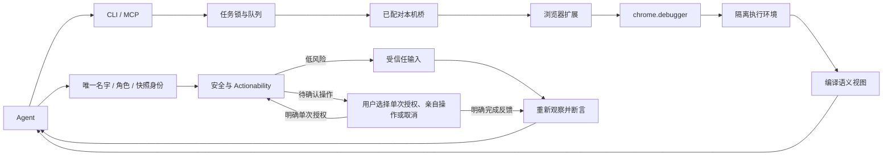

# 架构与执行链

AVS 是浏览器语义交互工具。调用方 Agent 负责理解任务、制定步骤和判断结果；AVS 负责观察、定位、执行、验证及安全降级。

## 分层

```text
agentviews.mjs / mcp.mjs       CLI 与 MCP 入口
src/cli/                      参数、任务路由、文本输入与监听 worker
src/mcp/                      MCP 参数契约与 CLI 适配
src/browser/                  DOM、语义编译、动作与证据读取
src/core/                     页面契约、任务状态、锁、队列、监听元数据
src/policy/                   导航、动作、敏感输入识别与默认确认
src/transport/                双向鉴别、扩展桥、CDP 与 daemon
src/platform/                 跨系统浏览器发现及启动
src/setup/                    安装、技能分发与本机私有配对
bridge-ext/                   Chrome API、认证轮询、目标归属和超时保护
tests/                        离线、模拟扩展和隔离浏览器夹具
```

根目录入口仅委托对应模块。资源通过 `import.meta.url` 定位，不依赖工作目录或开发者机器路径。生产运行不依赖 Playwright；可选集成测试使用它启动独立本地 Chromium。

## 操作链



节点身份包含文档和快照版本。发现、定位、派发与业务完成是不同阶段；名字相同不是文档身份相同。重名、遮挡、禁用、移动或结果未知均不自动猜测或重放。

## 语义契约

`avs.semantic-page/1` 包含文档身份、观察版本、节点、动作、状态、来源、置信度及变化摘要。

- `observe` 重新编译；`read` 按唯一目标获取文本；`verify` 先刷新再验证。
- 默认限制节点和正文体积；`--full` 显式扩大范围。弹窗和关键交互节点独立保留，不被普通节点截断掩盖。
- 开放 Shadow DOM 的命中会逐层验证实际接收元素；闭合 Shadow DOM 不宣称可访问。
- 原生 textarea 与保留空白的 contenteditable 有受保护的输入链。自定义编辑器代理通过 `editor_capability` 降级，不把空代理值当作完整源码。
- `frames` 只返回嵌入文档的存在和 origin 信息，不包含 query、fragment 或凭据，也不表示子文档正文已被读取或可自动操作。
- 敏感 autocomplete、密码/验证码语义及已识别敏感文本不从通用页面文本或编辑器值通道返回。

完整快照只能证明当前可观测 DOM，不等于服务器已接受操作、代码编译成功或业务正确。

## 持续监听链

```text
Agent watch start
  → 验证原授权目标
  → 原子保存私有监听元数据
  → detached 采样 worker
  → 同一 CLI observe（任务锁 / 既有 daemon 队列 / 扩展桥）
  → 语义摘要与有界事件游标
  → Agent poll / 显式读取最新页面
```

监听目标、浏览器会话和期限固定。worker 不执行点击、输入、导航、提交、相机操作或自动选页。临时读取失败恢复读取；目标或会话改变时停止。页面正文仅在观察进程内参与摘要计算，不写入监听文件。

CLI/MCP 回合结束不终止已启动的采样。`watch resume` 使用原 ID、期限和游标恢复停止工作的采样进程，不迁移目标或恢复写操作。状态/游标操作在本机执行，不在 daemon 命令队列中等待回入自己的子命令。

监听不包含模型调度或宿主 Agent 的唤醒接口；浏览器/系统休眠、强杀和瞬时页面变化仍可能造成观察缺口。详见 [监听与任务状态](long-tasks.md)。

## 信任边界

- 网页文本、HTML、class、JavaScript 和效果推断是不可信输入，不是授权。
- 内部编译与动作位于隔离执行环境，页面不能替换该环境捕获的策略函数。公共 `eval` 仅无副作用读取。
- 扩展桥和 daemon 双向鉴别、防重放，并绑定浏览器会话；仅监听本机回环。
- 配对只存在于源码外的安装目录，安装参数和已有凭据写前校验；资源复制不覆盖生成的配对配置。
- HMAC 不隔离具有同一 OS 用户文件访问权的进程。读取结果返回调用方 Agent，调用方的数据处理政策仍需用户确认。

## 状态、并发与释放

| 路径 | 行为 |
| --- | --- |
| CLI / daemon 请求 | 取任务锁后刷新状态，串行执行；不同请求不覆盖陈旧缓存 |
| 发现或定位失败 | 返回 `needs_agent_review`，不伪造成功、不派发猜测动作 |
| 敏感或登录阻塞 | 有确认请求时等待用户选择单次执行/亲自操作/取消；登录墙按人工登录或跳过处理 |
| CDP 超时或断连 | 释放 pending、计时器和监听器；已派发结果未知不重放，下一次只读操作可重新连接原目标 |
| 扩展迟到附加 | 附加后派发前复核期限；迟到结果保留未知状态，补偿分离确认前不宣称清理完成 |
| watch stop / 期限 / 目标变化 | 停止后续采样，释放 worker 等待，不关闭用户页 |
| keep / done | 停止当前上下文的监听，再按所有权保留或清理；不关闭用户浏览器 |
| 强杀 / 状态损坏 / 遗留锁 | 保留证据并报错，不默默清空安全状态或猜测旧任务已停止 |

## 验证边界

离线和隔离夹具覆盖签名、状态、任务锁、扩展异步、语义编译、策略、命中、受信任输入、监听与恢复。不能据此宣称所有操作系统、浏览器品牌、企业策略或恶意页面都已验证。

[命令](commands.md) · [操作确认](authorization.md) · [接入](agent-integration.md)
